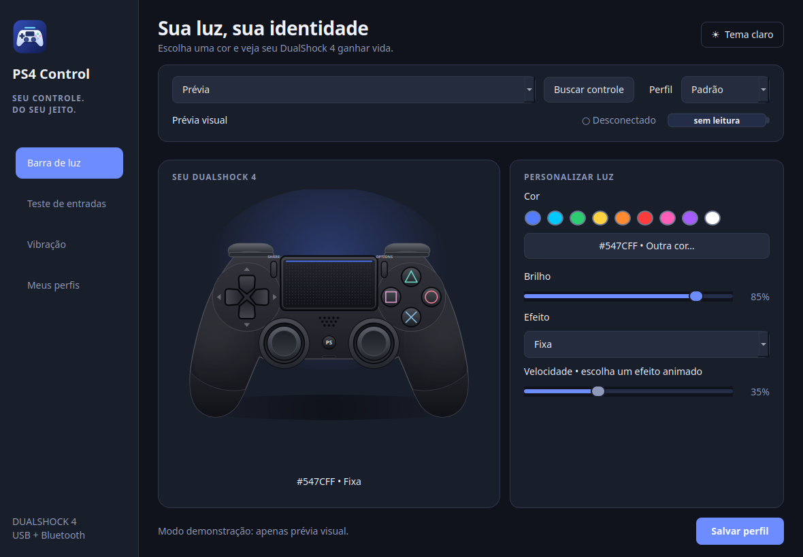

# PS4 Control para Linux

[](https://github.com/Rk7gamerYT/ps4-controler/actions/workflows/test.yml)

Projeto de código aberto sob a [licença MIT](LICENSE).



App nativo em português para configurar a barra de luz do DualShock 4:
cor RGB, brilho, pulsação, arco-íris, desligar a luz e perfis por controle.

A organização funcional é inspirada no DS4Windows, com implementação nativa para Linux.

## Bateria na bandeja

O ícone mostra a porcentagem do controle selecionado, com atualização a cada três
segundos. `?` indica controle desconectado ou bateria não informada pelo driver.
O menu do ícone tem **Abrir aplicativo** e **Sair**; clicar no ícone abre a janela.
Fechar a janela mantém o app e os efeitos de luz ativos quando a bandeja está
disponível. Para encerrar, use **Sair**. Sem bandeja, fechar encerra normalmente.

No GNOME, ative a extensão AppIndicator/KStatusNotifierItem correspondente à sua
distribuição (o Ubuntu normalmente já inclui Ubuntu AppIndicators).

## Perfis por controle

1. Selecione o controle no topo da janela.
2. Em **Meus perfis**, crie um perfil em **Novo** ou escolha um perfil existente.
3. Ajuste a luz e as intensidades do teste de vibração.
4. Clique em **Salvar perfil** (ou Ctrl+S) para salvar os ajustes e associar o perfil ao controle selecionado.

Ao selecionar novamente ou reconectar o controle, o perfil associado é carregado.
A associação usa `HID_UNIQ` (normalizado), quando disponível, permitindo reconhecer
um mesmo controle entre USB e Bluetooth se o driver informar o mesmo identificador.
Sem identificador único, usa o caminho da porta/dispositivo e mostra essa limitação;
nesse caso a associação pode mudar após reiniciar ou trocar a porta.

Perfis podem ser compartilhados por vários controles: editar um perfil altera os
ajustes de todos que usam esse perfil. Use **Novo** para copiar e personalizar
independentemente. Importar/exportar usa JSON próprio do PS4 Control; não lê o XML
do DS4Windows. **Excluir** remove também as associações àquele perfil.
A luz e a leitura de entradas são controladas apenas para o controle selecionado.
Alterações não salvas ficam em memória durante a sessão; use Salvar antes de fechar.

## Interface

- Cabeçalho com seleção de controle e perfil, status de conexão e barra de bateria.
- Navegação lateral: **Barra de luz**, **Teste de entradas**, **Vibração** e **Meus perfis**.
- Desenho vetorial do controle com acabamento preto, touchpad texturizado e botões animados.
- Tema escuro/claro (botão no topo; a escolha fica em `~/.config/ps4-controler/ui.json`).
- Atalho **Ctrl+S** para salvar.

## Recursos nesta versão

- Barra de luz com prévia ao vivo no desenho do controle, cores rápidas e efeitos animados.
- Perfis nomeados (novo, duplicar, renomear, excluir), importação/exportação JSON e associação por controle.
- Nome, conexão e bateria quando informados pelo driver, com porcentagem na bandeja.
- Teste visual de botões, direcional, analógicos e gatilhos em tempo real, com valores numéricos.
- Teste dos dois motores de vibração com duração limitada a 700 ms.

## Próximas funções baseadas no DS4Windows

Remapeamento de botões, zonas mortas e curvas aplicadas aos jogos, controle virtual,
perfis automáticos por jogo, touchpad e giroscópio exigem uma camada `evdev/uinput`.
Esses recursos ainda não estão implementados. O monitor atual exibe os valores
reais das entradas e não altera a resposta do controle nos jogos.

Referência funcional: https://github.com/ds4windowsapp/DS4Windows
Referência Linux: https://python-evdev.readthedocs.io/en/latest/tutorial.html

## Executar

```bash
git clone https://github.com/Rk7gamerYT/ps4-controler.git
cd ps4-controler
./install.sh
./run.sh
```

Requer Python 3.10+ e suporte a venv. Na primeira execução, o script instala Qt/PySide6 no ambiente local. `./run.sh --demo` mostra a prévia sem acessar o controle.

Conecte por USB ou emparelhe pelo Bluetooth do Linux (segure SHARE + PS até a luz piscar). A detecção é atualizada a cada três segundos.

## Driver e dependências do sistema

O instalador verifica o driver nativo `hid-playstation`. Para carregá-lo, use
`./install.sh --load-driver` ou `./driver/setup.sh --load`. Veja a
[integração com o driver](driver/README.md), incluindo origem e licença do kernel.

Instale os pré-requisitos conforme sua distribuição:

```bash
# Ubuntu / Debian
sudo apt install python3 python3-venv python3-dev build-essential kmod pkexec libegl1 libgl1 libxkbcommon0

# Fedora
sudo dnf install python3 python3-devel gcc kmod polkit

# Arch Linux
sudo pacman -S python python-pip base-devel kmod polkit
```

O módulo vem com o kernel da distribuição e não é baixado como binário separado.
A instalação não altera permissões globais dos dispositivos de entrada.

## Compatibilidade

Usa `/sys/class/leds/*:rgb:indicator`, `multi_index`, `multi_intensity` e `brightness` do driver `hid-playstation`. Detecta IDs Sony DS4 v1, v2 e adaptador USB. Também reconhece LEDs separados `:red`, `:green`, `:blue` e `:global`, em algumas versões do driver. Controles genéricos não estão implementados. Steam ou jogos podem sobrescrever a cor.

Os efeitos são calculados pelo app e exigem que ele permaneça aberto. Ao fechar, fica a cor escolhida com brilho fixo (ou apagada se selecionado). As preferências ficam em `~/.config/ps4-controler/settings.json`, respeitando XDG_CONFIG_HOME. Não há remapeamento nem configuração de touchpad nesta versão; vibração está disponível como teste manual.

## Permissão da luz

O app não precisa executar como root. Use **Liberar acesso à luz…** e autorize na janela do sistema. Apenas os atributos da luz do controle selecionado passam a pertencer ao usuário, até desconectar ou reiniciar. Requer `pkexec`/PolicyKit.

Para liberar manualmente o formato RGB multicolor, localize o LED com `ls /sys/class/leds` e substitua o exemplo abaixo pelo nome exato do controle:

```bash
LED='/sys/class/leds/0003:054C:09CC.XXXX:rgb:indicator'
sudo chown "$USER" "$LED/brightness" "$LED/multi_intensity"
```

Isso libera apenas os dois atributos da luz até desconectar/reiniciar. Não use esse exemplo literalmente: o identificador muda por dispositivo. Não altera permissões de hidraw ou dos controles de entrada.

## Permissões de entradas e vibração

O monitor usa apenas o nó de gamepad do HID selecionado, sem capturar o controle
com acesso exclusivo. Falhas de permissão aparecem na seção **Teste de entradas**.
O teste de vibração precisa de acesso de escrita ao mesmo `/dev/input/eventN`.

Para identificar o nó, use `ls -l /sys/class/leds/NOME-EXATO-DO-LED/device/input/input*/event*`.
Se esse caminho não existir, siga o link com `readlink -f /sys/class/leds/NOME-EXATO-DO-LED`
e procure `input/input*/event*` no ancestral HID que contém `uevent` com `HID_ID`.
O app escolhe o nó com botões de gamepad, evitando o touchpad e os sensores.

Se necessário, libere temporariamente só o nó desse gamepad com ACL (substitua o número correto):

```bash
sudo setfacl -m "u:$USER:rw" /dev/input/eventN
```

A permissão termina ao recriar o dispositivo. A configuração permanente via udev
fica para uma próxima versão. Não é necessário executar o app inteiro como root.
Em algumas distros `evdev` compila na instalação e requer compilador C e headers
de desenvolvimento do Python.

## Verificação

```bash
.venv/bin/python -m unittest discover -s tests
QT_QPA_PLATFORM=offscreen .venv/bin/python app.py --demo --smoke-test
```

Referência do driver: https://github.com/torvalds/linux/blob/master/drivers/hid/hid-playstation.c

## Contribuições

Veja [CONTRIBUTING.md](CONTRIBUTING.md). O projeto é independente e não é afiliado à Sony ou ao DS4Windows.

## Ícone e atalho no menu

Execute `python3 install-menu.py` para instalar o ícone e o atalho somente para o usuário atual. Procure PS4 Control no menu de aplicativos. O ícone da janela é atualizado ao reabrir o app.
